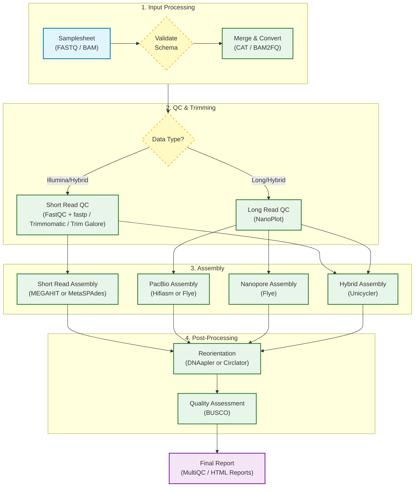

# ProkASM Pipeline Design & Feature Report

## 1. Executive Summary
ProkASM is a robust, modular Nextflow (DSL2) pipeline designed for the de novo assembly of prokaryotic genomes. It standardizes the analysis of **Illumina** (short-read), **PacBio** (HiFi/Long-read), **Nanopore** (Ultra-long), and **Hybrid** datasets. The pipeline emphasizes ease of use, reproducibility, and flexibility, handling raw inputs (FASTQ/BAM) through to polished, circularized genome assemblies and quality assessment.

## 2. Pipeline Architecture
The pipeline is built using **Nextflow DSL2**, separating process definitions (modules) from workflow logic (subworkflows).

### Core Components
*   **Main Entry Point (`main.nf`)**: Handles input parsing, validation, multi-lane merging, and routing to subworkflows.
*   **Subworkflows**: Specialized logic for each data type (`IlluminaWorkflow`, `PacBioWorkflow`, `NanoporeWorkflow`, `HybridWorkflow`).
*   **Modules**: Atomic process wrappers for bioinformatics tools (e.g., `fastqc`, `megahit`, `flye`).
*   **Configuration**: Centralized config `nextflow.config` with execution profiles (`standard`, `cluster`, `slurm`).

## 3. Workflow Diagram
The following chart illustrates the logic and routing of the pipeline:



## 4. Key Features

### A. Universal Multi-Lane & Multi-File Support
One of the pipeline's strongest features is its ability to handle complex input scenarios automatically:
*   **Illumina**: Automatically detects and merges multiple lanes (`L001`, `L002`) into a single R1/R2 pair per sample.
*   **Long Reads**: Merges multiple flowcell files.
    *   **BAM inputs** are merged using `samtools merge`.
    *   **FASTQ inputs** are concatenated (and gzipped if necessary).

### B. Format Agnostic Long-Read Support
The pipeline accepts both **BAM** and **FASTQ** formats for PacBio and Nanopore data via the unified `--longread_format` parameter.
*   **BAM inputs** are automatically converted to FASTQ using `bam2fastq` before processing.
*   **Validation** ensures file extensions match the declared format to prevent downstream errors.

### C. Hybrid Assembly Integration
For hybrid datasets (Illumina + Long Read), the pipeline acts as a bridge:
1.  Processes Illumina reads (Trim/QC).
2.  Prepares Long reads (Convert/QC).
3.  Feeds both into **Unicycler**, the gold-standard hybrid assembler for bacteria, utilizing the long reads to bridge repetitive regions in the short-read assembly.

### D. Advanced Tooling & Flexibility
Users can swap underlying tools via command-line flags:
*   **Illumina Trimming**: `fastp` (speed), `trimmomatic` (legacy), or `trimgalore` (auto-detection).
*   **Assemblers**: 
    *   Illumina: `MEGAHIT` (fast/low-mem) or `MetaSPAdes` (sensitive).
    *   PacBio: `Hifiasm` (HiFi optimized) or `Flye`.
    *   Nanopore: `Flye` (with modes for raw, corrected, or high-quality reads).
*   **Circularization**: `DNAapler` (modern, DnaA-based reorientation) or `Circlator`.

## 5. Directory Structure
Results are organized logically for ease of access:
```text
results/
├── qc/                 # FastQC and NanoPlot reports
├── trimming/           # Cleaned reads
├── concatenated/       # Merged raw files (archival)
├── assembly/           # Final FASTA headers
├── dnaapler/           # Reoriented, circularized genomes
├── busco/              # Lineage-specific quality scores
└── pipeline_info/      # Execution traces and timelines
```

## 6. Validation & Reproducibility
*   **Schema Validation**: Inputs are validated against a strict JSON schema (using `nf-schema`).
*   **Containerization**: All processes run in Singularity containers (default) or Conda environments, ensuring identical software versions across different compute infrastructures.
*   **Traceability**: Every run generates an execution timeline, customized log, and trace file detailing resource usage for every task.
